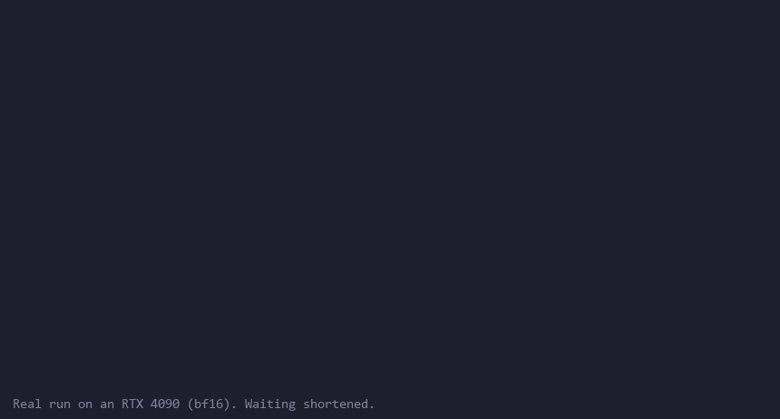
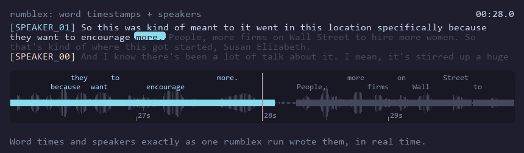

# rumblex

[](https://huggingface.co/spaces/edwardgl/rumblex)

Transcription with word timestamps, speaker labels and subtitles, built on
[Reson8/Rumble-2-Flash](https://huggingface.co/Reson8/Rumble-2-Flash).

Rumble-2-Flash has a CTC head next to its decoder. rumblex uses it for word timestamps: the decoder writes
the text and the CTC head aligns it to the audio, reusing the encoder pass that already ran. So alignment
is one linear layer and a Viterbi search, not a second model.

The model is a 0.5B fine-tune of Qwen3-ASR-0.6B. Its card lists 45 languages; I've only benchmarked English
and Dutch. You can try it in the browser with the [demo Space](https://huggingface.co/spaces/edwardgl/rumblex).



> Independent project, not affiliated with Reson8.

## Features

- Any input ffmpeg reads. Long files are split into speech chunks with Silero VAD.
- Batched transcription; a chunk's output doesn't depend on what it's batched with. Exposes the model's
  `language`, `prompt` (hotwords), `digits`, `filler` and `verbatim` options.
- Word timestamps from the CTC head. If alignment fails on a chunk, its words get proportional times.
- Optional per-word speaker labels via pyannote.
- JSON, SRT, VTT (optionally with karaoke tags), TSV and TXT.



## Install

```bash
pip install rumblex
pip install "rumblex[diarize]"   # with speaker labels
```

Needs Python 3.11 or 3.12 and ffmpeg on `PATH`. On Windows, PyPI's torch is CPU-only, so for a GPU install
torch and torchaudio from [pytorch.org](https://pytorch.org/get-started/locally/) first. Ampere and newer
run in bf16, older GPUs in float32 (a 6 GB GTX 1060 works at the default batch size). CPU works but is slow.

From source, `git clone https://github.com/EdwardGlockner/rumblex && cd rumblex && uv sync` (add
`--extra diarize` for speaker labels). The lock file pins CUDA 12.6 wheels, which still support Pascal; for
RTX 50-series install torch yourself and use `pip install -e .`.

## Use

```bash
rumblex meeting.mp4                                   # all formats into the current folder
rumblex talk.wav -f srt vtt --max_line_width 42
rumblex interview.m4a --language Dutch --diarize -f srt txt
rumblex call.wav --prompt "Kubernetes, metoprolol"   # hotwords
```

```python
import rumblex

model = rumblex.load_model()
result = rumblex.transcribe("meeting.mp4", model)
for seg in result.segments:
    print(seg.start, seg.end, seg.text)
rumblex.write_result(result, "meeting.mp4", "out/", ["srt", "json"])
```

More in [examples/](examples/).

**vLLM.** On Linux, decoding can run on a vLLM server (`pip install "rumblex[vllm]"`):

```bash
vllm serve Reson8/Rumble-2-Flash --max-model-len 4096 --gpu-memory-utilization 0.5
rumblex meeting.mp4 --vllm_url http://localhost:8000/v1
```

Alignment still runs the encoder locally, so leave some GPU memory free. On LibriSpeech this went from 467×
to 601× real time with the same WER
([run](docs/bench_2026-11-20_rtx4090_release/README.md)).

**Speaker labels.** Accept the conditions on
[pyannote/speaker-diarization-community-1](https://huggingface.co/pyannote/speaker-diarization-community-1)
and run `hf auth login`. rumblex turns off pyannote's telemetry unless you set
`PYANNOTE_METRICS_ENABLED=true`.

## Compared with WhisperX

Same audio, one RTX 4090, one session, rumblex 0.1.0 (bf16, batch 32) vs WhisperX 3.8.6 with `large-v3`
(float16, batch 16, default aligners). Language given to both, Whisper's normalisers for WER. Speed is one
20–60 min file per dataset, models already loaded. Details and raw results:
[docs/bench_2026-11-20_rtx4090_release](docs/bench_2026-11-20_rtx4090_release/README.md).

| dataset | rumblex WER | WhisperX WER | rumblex speed | WhisperX speed |
|---|---|---|---|---|
| AMI meetings (500 utt.) | 10.9% | 17.2% | 329× real time | 104× |
| Earnings-22 calls (500 utt.) | 9.3% | 10.6% | 430× | 102× |
| LibriSpeech test-clean (200 utt.) | 2.2% | 1.6% | 467× | 92× |
| FLEURS Dutch (364 utt.) | 9.2% | 7.0% | 380× | 79× |

rumblex is 3–5× faster, mostly because alignment reuses the encoder (0.3–0.9 s per file vs 7–17 s for
WhisperX). It wins WER on meetings and calls, mostly through fewer deleted words; WhisperX wins on clean
English and Dutch. rumblex passes clips up to 20 s whole while WhisperX runs VAD on everything, which may
flatter rumblex on these short clips. A few hundred utterances per set, so treat it as rough.

The model card's 6.05% on FLEURS Dutch uses the Open ASR Leaderboard's scoring. Rescored that way, this
run gives 6.24% for rumblex and 4.43% for WhisperX
([run](docs/bench_2026-11-21_rtx4090_leaderboard/README.md)).

### Timestamp accuracy

200 LibriSpeech utterances against Montreal Forced Aligner references (another aligner, not human labels),
with the current aligner ([run](docs/bench_2026-11-22_rtx4090_timing/README.md),
settings chosen on dev-clean in [docs/alignment_eval.md](docs/alignment_eval.md)).

| mean absolute error | rumblex | WhisperX |
|---|---|---|
| word start | 53 ms | 75 ms |
| word end | 58 ms | 34 ms |

The encoder runs at 13 frames per second against WhisperX's 20 ms aligner, which shows in the ends. rumblex
pulls each word end back to where the audio goes quiet, and since 0.1.1 penalises the blank before Viterbi,
which took starts from 58 to 53 ms.

## How it works

1. ffmpeg decodes to 16 kHz mono.
2. Silero VAD packs speech into chunks of up to 20 s (shorter files go in whole).
3. Rumble-2-Flash transcribes the chunks in batches; a hook keeps the encoder states (13 frames/s).
4. The CTC head and Viterbi align the decoder's tokens to those states, grouped into words at spaces.
5. Optionally, pyannote labels speakers and each word gets the speaker it overlaps most.
6. Writers produce the output files.

Model details: [docs/model_inspection.md](docs/model_inspection.md).

## Limitations

- Timing resolution is limited to 13 frames/s; word ends are less precise than WhisperX's.
- Chunks are decoded independently, so a sentence crossing a chunk boundary can be broken there.
- Words split at spaces, so Chinese and Japanese get one "word" per chunk.
- WhisperX large-v3 had lower WER on clean English and Dutch. Only English and Dutch are measured.
- vLLM needs Linux and a GPU vLLM supports.

## Development

```bash
uv sync --extra dev
uv run pytest
uv run ruff check . && uv run ruff format --check .
```

Benchmark scripts are in [scripts/README.md](scripts/README.md), and every number above links to its raw
results ([docs/README.md](docs/README.md)).

## License

Apache-2.0, like Rumble-2-Flash. The pyannote models have their own terms.
